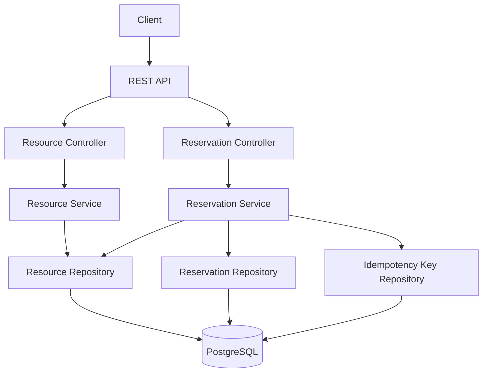
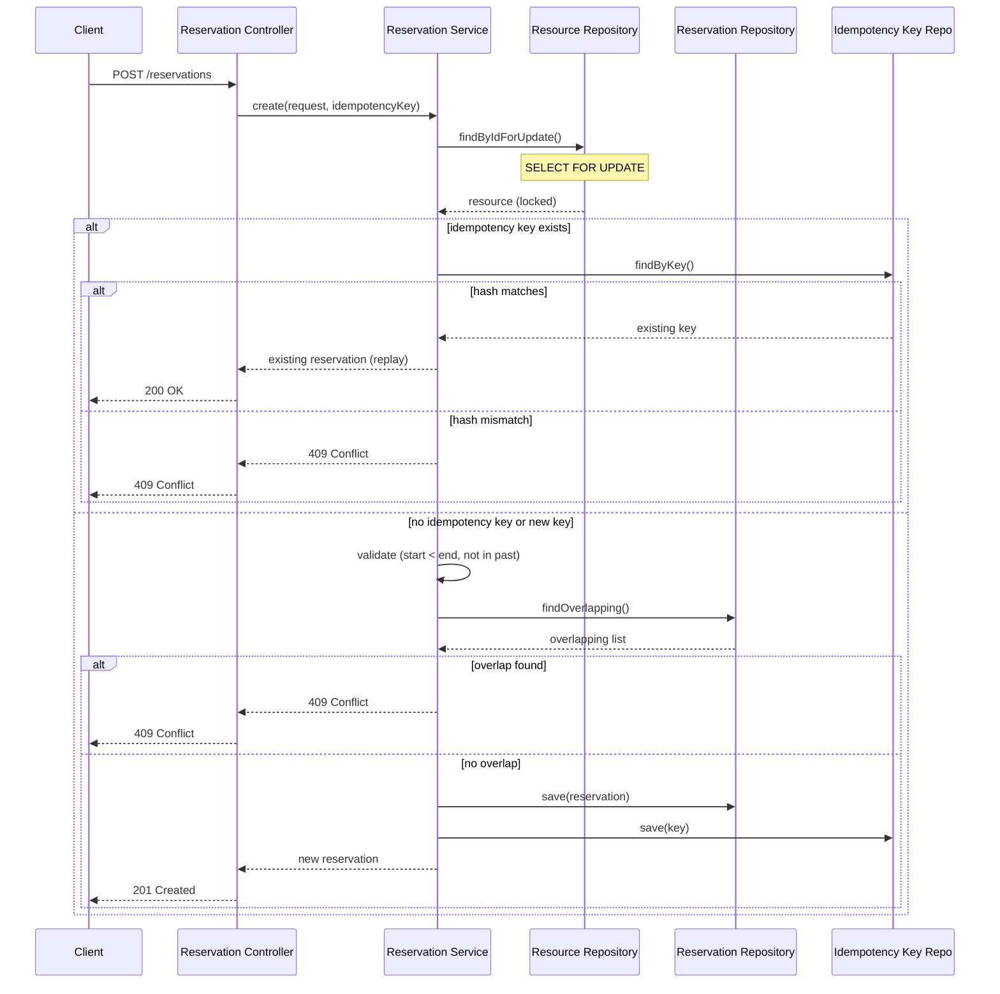

# Resource Reservation Service

A REST API for reserving shared resources (meeting rooms, equipment) for specified time intervals. Prevents overlapping reservations, supports cancellation, and handles idempotent requests.

## Technology Stack

- **Java 25** with **Spring Boot 4.1**
- **PostgreSQL 18** with **Flyway** migrations
- **Gradle 9** build system
- **Testcontainers** for integration tests
- **Docker Compose** for local deployment
- **springdoc OpenAPI** for API documentation

## Architecture

```
com.example.reservation
├── resource/          — Resource management (CRUD)
├── reservation/       — Reservation management with overlap prevention
└── common/            — Shared exceptions and error handling
```

## Business Rules

1. Only active resources can be reserved
2. Start time must be before end time
3. Start time must not be in the past
4. Two CONFIRMED reservations for the same resource cannot overlap (`[start, end)` half-open interval)
5. Adjacent reservations are allowed (end of A == start of B)
6. Cancelled reservations do not block future reservations
7. Cancellation is idempotent
8. Pessimistic locking prevents concurrent double-booking

## API Endpoints

| Method | Path | Description |
|--------|------|-------------|
| POST | `/api/v1/resources` | Create a resource |
| GET | `/api/v1/resources` | List all resources |
| GET | `/api/v1/resources/{id}` | Get resource by ID |
| POST | `/api/v1/reservations` | Create a reservation |
| GET | `/api/v1/reservations/{id}` | Get reservation by ID |
| GET | `/api/v1/reservations?customerId=` | List reservations by customer |
| POST | `/api/v1/reservations/{id}/cancellation` | Cancel a reservation |

## How to Start

```bash
docker compose up --build
```

The service starts on `http://localhost:8081`.

## How to Stop and Reset

```bash
docker compose down -v
```

This stops all containers and removes the PostgreSQL volume (data is lost).

## How to Run Tests

```bash
./gradlew test
```

Tests use Testcontainers with PostgreSQL 18.

## Example Requests

### Create a Resource

```bash
curl -X POST http://localhost:8081/api/v1/resources \
  -H "Content-Type: application/json" \
  -d '{"name": "Meeting Room A"}'
```

### Create a Reservation

```bash
curl -X POST http://localhost:8081/api/v1/reservations \
  -H "Content-Type: application/json" \
  -d '{
    "resourceId": "<uuid>",
    "customerId": "customer-1",
    "start": "2027-06-15T10:00:00Z",
    "end": "2027-06-15T11:00:00Z"
  }'
```

> **Note:** Replace the timestamps with future dates — the service rejects reservations with start times in the past.

### Cancel a Reservation

```bash
curl -X POST http://localhost:8081/api/v1/reservations/<uuid>/cancellation
```

### Idempotent Reservation

```bash
curl -X POST http://localhost:8081/api/v1/reservations \
  -H "Content-Type: application/json" \
  -H "Idempotency-Key: unique-key-123" \
  -d '{
    "resourceId": "<uuid>",
    "customerId": "customer-1",
    "start": "2027-06-15T10:00:00Z",
    "end": "2027-06-15T11:00:00Z"
  }'
```

## System Architecture



## Reservation Creation Sequence



## Important Assumptions

- **No authentication**: The API is open. Add auth in production.
- **Single database**: No distributed locking or sharding.
- **Development credentials**: Database credentials are not production-grade.
- **No pagination**: List endpoints return all results.
- **Idempotency key scope**: Idempotency is serialized per resource by the reservation lock. Global serialization of a client-supplied idempotency key across unrelated resources is intentionally deferred; production implementation should define key scope explicitly and enforce it.

## Tradeoffs

- **Pessimistic locking** vs optimistic: Chosen for simplicity and correctness under concurrency. May reduce throughput under heavy contention.
- **Idempotency key persistence**: Stored in the database for durability, not in-memory.
- **ProblemDetail responses**: Uses Spring's RFC 7807 support for consistent error format.

## Features Deliberately Omitted

This project focuses on demonstrating backend engineering fundamentals: domain correctness, transactional integrity, concurrency safety, idempotency, API design, testing, and reproducible local execution.

The following capabilities are intentionally excluded from the scope of this take-home assignment:

- **Authentication and authorization**: OAuth2/JWT integration and access-control policies. Authentication can be integrated through an API gateway or identity provider, while application-level authorization must be enforced wherever business rules require it.
- **Advanced observability**: Centralized logging, distributed tracing, custom business metrics, dashboards, and alerting. The application provides basic health checks and can be integrated with a production monitoring stack.
- **Rate limiting and traffic management**: Request throttling can be implemented at the API gateway or ingress layer, with additional application-level controls where required.
- **Infrastructure as Code**: Automated provisioning of cloud infrastructure using Terraform, AWS CloudFormation, or equivalent tools. The project provides Docker-based local execution rather than environment-specific infrastructure provisioning.
- **CI/CD**: Automated build, test, security scanning, and deployment pipelines. These can be added using the CI/CD platform selected for the target environment.
- **Production deployment and scaling**: Cloud deployment, high availability, autoscaling, disaster recovery, and environment-specific operational configuration.

These omissions are deliberate scope decisions rather than claims that the capabilities are unnecessary in production. The project includes the configuration required to build, test, and run the application locally using Docker Compose.

## Potential Next Steps

1. Add authentication/authorization
2. Add pagination to list endpoints
3. Add resource deactivation (soft delete)
4. Add notification on reservation creation/cancellation
5. Add metrics and monitoring
6. Add rate limiting
7. Add automated quality checks: Integrate code coverage reporting, static analysis, and dependency vulnerability scanning into a future CI pipeline.
8. Expand unit and integration tests to cover edge cases, failure scenarios, transaction rollbacks, and concurrent reservation requests.
9. Performance testing: Benchmark API latency, throughput, and database behavior under representative workloads, including concurrent reservation attempts and high contention for the same resource.
10. Fix idempotency cross-resource race: Add PostgreSQL advisory transaction locks for idempotency keys so that concurrent requests with the same key but different resources are serialized, preventing duplicate reservation creation.

## OpenAPI Documentation

When running, access:
- Swagger UI: `http://localhost:8081/swagger-ui.html`
- API docs: `http://localhost:8081/v3/api-docs`

## Health Check

```bash
curl http://localhost:8081/actuator/health
```
